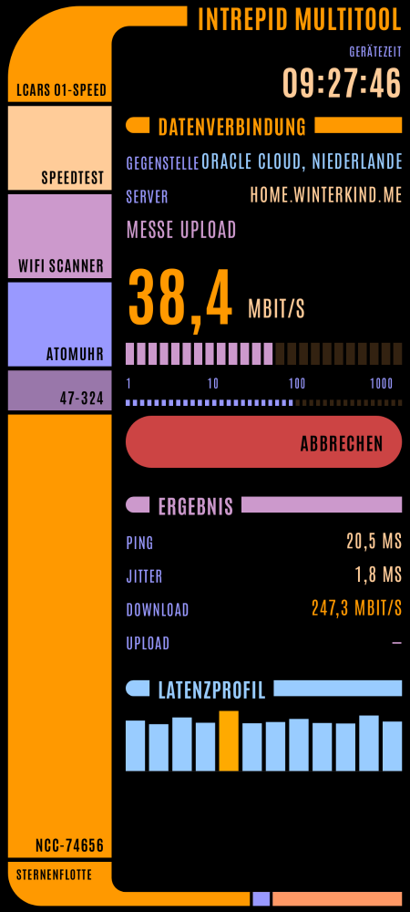
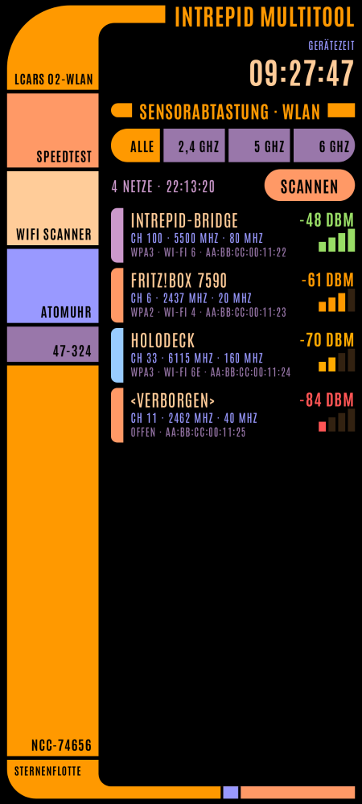
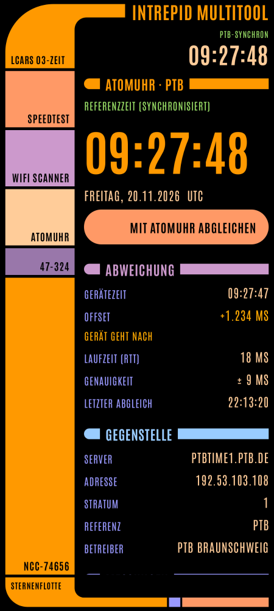

# Intrepid Multitool

Android-App für Technikinteressierte im LCARS-Design (Star Trek: TNG/Voyager).

| Speedtest | WiFi Scanner | Atomuhr |
|---|---|---|
|  |  |  |

## Funktionen

1. **Speedtest:** Ping, Jitter, Download und Upload gegen den eigenen Server
   `home.winterkind.me` (Oracle Cloud, Niederlande). Die Server-Einrichtung steht in
   [server/README.md](server/README.md).
2. **WiFi Scanner:** zeigt alle WLANs in Reichweite mit Kanal, Frequenz, Kanalbreite,
   Verschlüsselung, Wi-Fi-Standard und Signalstärke. Umschaltbar zwischen *Alle*, *2,4 GHz*,
   *5 GHz* und *6 GHz*, mit Kanalbelegungs-Diagramm pro Band.
3. **Atomuhr:** gleicht die Uhr in der Kopfzeile per SNTP mit den Stratum-1-Zeitservern der
   Physikalisch-Technischen Bundesanstalt (`ptbtime1–3.ptb.de`) ab. Angezeigt werden Offset,
   Laufzeit und Genauigkeit.

## Build

- Android Studio oder `./gradlew assembleDebug` (JDK 17+, Android SDK 35)
- minSdk 26 (Android 8.0), targetSdk 35
- Screenshots neu erzeugen: `./gradlew recordPaparazziDebug`

### GitHub Actions

Jeder Push baut eine APK und hängt sie als Artefakt an den Workflow-Lauf. Tags `v*` erzeugen
zusätzlich ein GitHub Release.

Für eine **signierte Release-APK** diese Repository-Secrets anlegen
(Settings → Secrets and variables → Actions):

| Secret | Inhalt |
|---|---|
| `KEYSTORE_BASE64` | Keystore-Datei, Base64-kodiert: `base64 -w0 release.jks` |
| `KEYSTORE_PASSWORD` | Passwort des Keystores |
| `KEY_ALIAS` | Alias des Schlüssels |
| `KEY_PASSWORD` | Passwort des Schlüssels |

Ohne `KEYSTORE_BASE64` baut der Workflow eine Debug-APK.

Keystore erzeugen, falls noch keiner existiert:

```bash
keytool -genkeypair -v -keystore release.jks -alias intrepid -keyalg RSA -keysize 4096 -validity 10000
```

## Lizenzen

Schrift *Antonio* (Vernon Adams) unter der SIL Open Font License 1.1.
Star Trek und LCARS sind Marken von CBS Studios / Paramount. Dies ist ein privates Fanprojekt
ohne Verbindung zu den Rechteinhabern.
